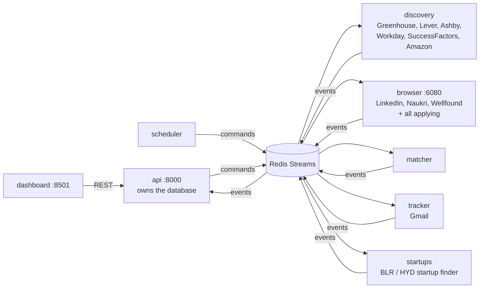

# Running Job Agent as microservices

The same agents, split into separate services that talk through Redis. Everything runs
with Docker Compose. The single-command CLI (`python -m jobagent ...`) still works on its own.

## Services



| Service | What it does | Listens to | Publishes |
|---|---|---|---|
| `api` | REST API (docs at `/docs`) and the **only** service that writes to the database | job, email and company events | `evt.job.new`, commands |
| `discovery` | Job sources with public APIs. Also adds the startup boards found by `startups` | `cmd.discover` | `evt.job.discovered` |
| `browser` | LinkedIn, Naukri and Wellfound discovery, and every application. One browser at a time | `cmd.discover`, `cmd.apply` | `evt.job.discovered`, `evt.job.apply_result`, `evt.job.description` |
| `matcher` | Scores each new job | `evt.job.new` | `evt.job.scored` |
| `tracker` | Reads your inbox (read-only) | `cmd.track` | `evt.email.received` |
| `startups` | Finds Bangalore / Hyderabad startups with a public careers board | `cmd.find_startups` | `evt.company.checked` |
| `scheduler` | Sends commands on the timetable in `[schedule]` | – | commands |
| `dashboard` | The Streamlit UI, reading from the API | – | – |
| `redis` | Message bus (Redis Streams, one consumer group per service) | – | – |

Each message is acknowledged after it's handled. If a handler fails, the message is copied to the `dead-letter` stream and the error is logged. Handlers are idempotent, so a message delivered twice does no harm.

## First start (Windows PowerShell)

Install [Docker Desktop](https://www.docker.com/products/docker-desktop/) and start it. Then:

```powershell
git clone https://github.com/muttarasusujitha/jobsearch-.git
cd jobsearch-

Copy-Item config\profile.example.toml config\profile.toml
notepad config\profile.toml                     # fill in your details
Copy-Item "C:\path\to\resume.pdf" config\resume.pdf

Copy-Item .env.example .env
notepad .env                                    # Gmail app password, optional API token / VNC password

docker compose up -d --build
```

Then open:

| URL | What |
|---|---|
| http://localhost:8501 | Dashboard |
| http://localhost:6080/vnc.html | The agent's browser: watch it, log in, solve CAPTCHAs |
| http://localhost:8000/docs | API documentation |

### Log in to job sites (once)

Open http://localhost:6080/vnc.html in one window, and run these in PowerShell:

```powershell
docker compose exec browser python -m jobagent login linkedin
docker compose exec browser python -m jobagent login naukri
docker compose exec browser python -m jobagent login wellfound
docker compose exec browser python -m jobagent login workday
docker compose exec browser python -m jobagent login successfactors
```

Each command opens the site in the noVNC window. Log in there, then press Enter in PowerShell.
Sessions are kept in the `browser-profiles` volume.

## Everyday commands

```powershell
docker compose ps                 # what's running
docker compose logs -f            # all logs (add a service name to filter, e.g. browser)
docker compose restart browser    # restart one service
docker compose up -d --build      # after pulling new code
docker compose down               # stop everything (data is kept in volumes)
```

Start agents from the dashboard sidebar or the API:

```powershell
Invoke-RestMethod -Method Post http://localhost:8000/runs/discover
Invoke-RestMethod -Method Post http://localhost:8000/runs/find_startups
Invoke-RestMethod -Method Post http://localhost:8000/runs/apply -ContentType application/json -Body '{"dry_run": true, "limit": 3}'
```

If you set `JOBAGENT_API_TOKEN`, add `-Headers @{Authorization = "Bearer <token>"}`.

## Security

- All ports are bound to `127.0.0.1`, so only your computer can reach the dashboard, API and browser viewer.
- Set `JOBAGENT_API_TOKEN` in `.env` to require a token on every API call. The services and dashboard send it automatically.
- Set `VNC_PASSWORD` to protect the browser viewer.
- `config/` is mounted read-only, and passwords live only in `.env`, which git ignores.

## Limits

- The database is SQLite, owned by the `api` service (one writer). That's plenty for one person. Moving to PostgreSQL would only change `jobagent/db.py`.
- `browser` handles one task at a time, because a browser profile can only be opened by one process. Don't scale it beyond one instance.
- `discovery`, `matcher`, `tracker` and `startups` can be scaled (`docker compose up -d --scale matcher=2`). Redis consumer groups share the work between instances.
